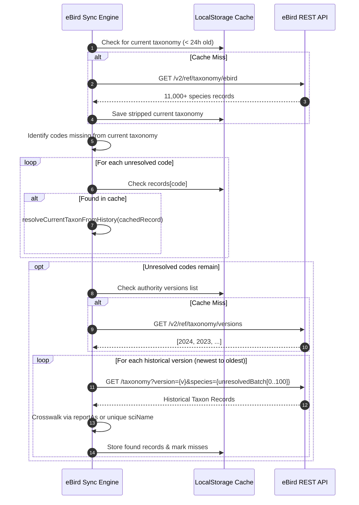

# eBird API Integration & Taxonomy Synchronization Architecture

This document provides a comprehensive technical reference for the eBird APIs utilized in Telebirding, the automated synchronization engine implemented in the Admin UI, the historical taxonomy crosswalk algorithm, and the supporting batch utilities.

---

## 1. Overview & Architectural Role

Telebirding relies on [eBird](https://ebird.org/) as the authoritative source of truth for all avian taxonomic data:
- **Taxonomic Codes (`speciesCode`)**: Stable 6–8 character identifiers (e.g., `tafowl1` for Tawny Owl) used to uniquely identify bird taxa across global taxonomy versions.
- **Scientific Nomenclature (`sciName` / `latin_name`)**: Binomial and trinomial Latin names reflecting the latest Clements / eBird taxonomy.
- **Standardized Common Names (`comName`)**: English common names maintained by the global ornithological authority.
- **Higher Taxonomic Ranks (`familyComName`, `familySciName`, `familyCode`)**: Taxonomic family groupings for hierarchical navigation.
- **Public Reference Links**: Deep links directly to species accounts on eBird (`https://ebird.org/species/{code}`).

### System Context

```mermaid
flowchart TD
    subgraph eBird Cloud
        E1["Taxon Find API<br/>(/v2/ref/taxon/find)"]
        E2["Current Taxonomy API<br/>(/v2/ref/taxonomy/ebird)"]
        E3["Taxonomy Versions API<br/>(/v2/ref/taxonomy/versions)"]
        E4["Historical Taxonomy API<br/>(/v2/ref/taxonomy/ebird?version=X)"]
    end

    subgraph Client Admin UI [webapp/scripts/modules/admin/ebird-sync.js]
        Cache["Browser LocalStorage Cache<br/>(TTL: 24 Hours)"]
        Engine["Taxonomy Comparison & Crosswalk Engine"]
        Safety["Conflict & Duplicate Guard"]
        ReviewUI["Interactive Review & Selection UI"]
    end

    subgraph Python CLI Tool [utils/fetch-ebird-data.py]
        PyScript["Batch Name & Code Enricher"]
    end

    subgraph Firebase Cloud Storage
        SpeciesJSON["data/bird-species.json"]
        FamiliesJSON["data/bird-families.json"]
    end

    E1 -->|Search query| PyScript
    E1 -->|Search query| Engine
    E2 -->|Full taxonomy dump| Cache
    E3 -->|Authority versions list| Cache
    E4 -->|Historical code batch lookup| Cache

    Cache <--> Engine
    Engine --> Safety
    Safety --> ReviewUI
    ReviewUI -->|Admin Approval| SpeciesJSON
    ReviewUI -->|Admin Approval| FamiliesJSON
    PyScript -->|Offline Batch Sync| SpeciesJSON
```



---

## 2. eBird API Endpoints Reference

All requests to eBird API v2 endpoints require an API key passed via the `key` query parameter or `X-eBirdApiToken` header. Telebirding configures this in [ebird-api.js](file:///d:/Projects/telebirding/webapp/scripts/modules/ebird-api.js):

```javascript
export default class EbirdApi {
    static apiKey = "jfekjedvescr";
}
```

### 2.1. Taxon Search: `ref/taxon/find`

Used for on-the-fly resolution of common names to eBird species codes.

- **Endpoint**: `GET https://api.ebird.org/v2/ref/taxon/find`
- **Implemented In**:
  - Web UI: [EbirdApi.fetchEbirdCode](file:///d:/Projects/telebirding/webapp/scripts/modules/ebird-api.js#L4-L24)
  - CLI Script: [find_species_code](file:///d:/Projects/telebirding/utils/fetch-ebird-data.py#L7-L23)
- **Parameters**:
  | Parameter | Type | Required | Description |
  | :--- | :--- | :--- | :--- |
  | `q` | `string` | Yes | Search query (species common or scientific name). |
  | `cat` | `string` | No | Category filter (e.g., `species`). |
  | `locale` | `string` | No | Response language (default `en`). |
  | `key` | `string` | Yes | eBird API Key. |

- **Sample Request**:
  ```http
  GET /v2/ref/taxon/find?cat=species&key=jfekjedvescr&locale=en&q=Tawny%20Owl HTTP/1.1
  Host: api.ebird.org
  ```

- **Sample Response**:
  ```json
  [
    {
      "code": "tafowl1",
      "name": "Tawny Owl - Strix aluco"
    }
  ]
  ```

- **Name Normalization & Matching Rules**:
  1. **Curly Apostrophe Sanitization**: Unicode quotation marks `\u2018` and `\u2019` (`’`, `‘`) are normalized to standard ASCII `'` (e.g., *Jerdon’s Baza* $\rightarrow$ *Jerdon's Baza*).
  2. **Hyphen Stripping**: The response `name` string (`Common Name - Scientific Name`) is split at ` - ` to isolate the common name.
  3. **Parenthetical Disambiguation**: Any parenthetical region descriptors (e.g., `Indian Peafowl (Feral)`) are stripped via `/\s*\([^)]*\)/g` to match base species names.

---

### 2.2. Current Taxonomy: `ref/taxonomy/ebird`

Fetches the complete current active taxonomy or individual taxon records.

- **Endpoint**: `GET https://api.ebird.org/v2/ref/taxonomy/ebird`
- **Implemented In**:
  - Full Taxonomy Sync: [fetchTaxonomy](file:///d:/Projects/telebirding/webapp/scripts/modules/admin/ebird-sync.js#L68-L99)
  - Single Code Lookup: [EbirdApi.fetchEbirdSciName](file:///d:/Projects/telebirding/webapp/scripts/modules/ebird-api.js#L26-L33)
  - Python Utility: [get_latin_name](file:///d:/Projects/telebirding/utils/fetch-ebird-data.py#L25-L38)
- **Parameters**:
  | Parameter | Type | Required | Description |
  | :--- | :--- | :--- | :--- |
  | `cat` | `string` | No | Category filter (`species`, `slash`, `issf`, etc.). |
  | `fmt` | `string` | No | Format (`json` or `csv`). Default `json`. |
  | `locale` | `string` | No | Localization (default `en`). |
  | `key` | `string` | Yes | eBird API Key. |
  | `species` | `string` | No | Comma-delimited list of 6-8 letter species codes. |
  | `version` | `string` | No | Authority version year (e.g., `2024`, `2023`). |

- **Sample Response Item**:
  ```json
  {
    "sciName": "Strix aluco",
    "comName": "Tawny Owl",
    "speciesCode": "tafowl1",
    "category": "species",
    "taxonOrder": 6732.0,
    "bandingCodes": [],
    "comNameCodes": [],
    "sciNameCodes": [],
    "order": "Strigiformes",
    "familyCode": "strigi1",
    "familyComName": "Owls",
    "familySciName": "Strigidae",
    "reportAs": null
  }
  ```

---

### 2.3. Historical Taxonomy Versions: `ref/taxonomy/versions`

Retrieves all published eBird/Clements authority versions. Used to discover historical release years when resolving deprecated or split species codes.

- **Endpoint**: `GET https://api.ebird.org/v2/ref/taxonomy/versions`
- **Implemented In**: [fetchTaxonomyVersions](file:///d:/Projects/telebirding/webapp/scripts/modules/admin/ebird-sync.js#L125-L142)
- **Parameters**:
  | Parameter | Type | Required | Description |
  | :--- | :--- | :--- | :--- |
  | `key` | `string` | Yes | eBird API Key. |

- **Sample Response**:
  ```json
  [
    { "authorityVer": 2024 },
    { "authorityVer": 2023 },
    { "authorityVer": 2022 },
    { "authorityVer": 2021 }
  ]
  ```

---

### 2.4. Historical Taxonomy Code Queries: `ref/taxonomy/ebird?version={year}&species={codes}`

Queries historical taxonomic records in bulk (chunks of 100) to find how legacy or obsolete species codes were classified in previous authority versions.

- **Endpoint**: `GET https://api.ebird.org/v2/ref/taxonomy/ebird?cat=species&fmt=json&locale=en&key={key}&version={version}&species={codes}`
- **Implemented In**: [fetchTaxonomyForCodes](file:///d:/Projects/telebirding/webapp/scripts/modules/admin/ebird-sync.js#L144-L157)
- **Batch Size Limit**: 100 species codes per query.

---

## 3. The Synchronization Engine (`ebird-sync.js`)

The core synchronization engine operates inside the Admin Portal under Bird Mode (`Constants.MODE_BIRD`). It performs diffing, legacy resolution, conflict detection, and batch writing.

### 3.1. LocalStorage Caching Strategy

The complete eBird species taxonomy contains over 11,000 records (~3.5 MB JSON). To avoid hitting rate limits or slowing down the UI, a persistent browser cache is maintained in `localStorage` under the key:

```text
telebirding-ebird-taxonomy-history-v1
```

- **Cache TTL**: 24 hours (`TAXONOMY_CACHE_TTL_MS = 24 * 60 * 60 * 1000`).
- **Cache Payload Structure**:
  ```typescript
  interface TaxonomyCache {
      versionsFetchedAt: number;        // Epoch timestamp
      versions: string[];               // e.g. ["2024", "2023", "2022"]
      currentFetchedAt: number;         // Epoch timestamp
      currentTaxonomy: Array<{          // Stripped fields to fit localStorage quota
          speciesCode: string;
          comName: string;
          sciName: string;
          familyComName: string;
          familySciName: string;
          familyCode: string;
          reportAs: string | null;
          category: string;
      }>;
      records: Record<string, TaxonRecord>; // Map of resolved historical codes
      misses: Record<string, boolean>;     // Cache of negative queries: "${version}:${code}"
  }
  ```
- **Storage Optimization**: The full eBird response contains unused banding codes, orders, and checklists. The cache explicitly strips everything except the 8 fields necessary for diffing, keeping storage within standard browser quotas.

---

### 3.2. Historical Taxonomy Crosswalk Algorithm

When local species contain codes not present in the current eBird release (due to taxonomic splits, lumps, or deprecations), the engine resolves them using historical records:



#### Crosswalk Logic: `resolveCurrentTaxonFromHistory`
[resolveCurrentTaxonFromHistory](file:///d:/Projects/telebirding/webapp/scripts/modules/admin/ebird-sync.js#L159-L171) evaluates the historical taxon record against the current taxonomy:
1. **Direct `reportAs` Mapping**: If the historical taxon explicitly specifies a `reportAs` property that exists in the current taxonomy, map to that taxon.
2. **Scientific Name Invariant**: If no `reportAs` is present, look for an exact case-insensitive match on scientific name (`sciName`). If exactly **one** current taxon shares that scientific name, map to it.
3. **Ambiguity Abort**: If multiple current species share that scientific name (or none do), the record cannot be mapped automatically and is routed to the manual review warnings queue.

---

### 3.3. Conflict & Duplicate Detection Rules

Before any change is proposed or applied, two critical validation checks protect the database:

#### 1. Taxonomy Code Conflict Check (`hasTaxonomyCodeConflict`)
[hasTaxonomyCodeConflict](file:///d:/Projects/telebirding/webapp/scripts/modules/admin/ebird-sync.js#L31-L42) prevents corruption when a local species was accidentally assigned the code of a completely different bird:
- Resolves the local common name against the current taxonomy.
- If the local name resolves to `localNameCode`, but the stored code is different (`code !== localNameCode`):
  - **Result**: Flagged as a **Mismatch Warning**.
  - **Behavior**: The record is shown in the "Needs review — not selectable" banner with direct links to both eBird taxa. No automatic rename or update is permitted.

#### 2. Duplicate Species Conflict Check (`hasDuplicateSpeciesConflict`)
[hasDuplicateSpeciesConflict](file:///d:/Projects/telebirding/webapp/scripts/modules/admin/ebird-sync.js#L44-L54) prevents renaming that would collide with another species:
- Checks if the proposed target common name or slugified key matches any other existing local species record.
- **Behavior**: Flagged as a **Collision Warning**. Automatic renames that would merge two distinct records are blocked.

---

### 3.4. Dependency-Aware Change Application

When applying selected updates in the Admin UI:

1. **Family Dependency Resolution**:
   - If a proposed species update changes the bird's family to one that does not exist in [bird-families.json](file:///d:/Projects/telebirding/webapp/resources/data/bird-families.json), the engine automatically creates the family record with `name`, `ebird_code`, and `sci_name`.
   - The required family record is automatically bundled into the transaction, even if the admin did not manually select the family row.
2. **Old Name Archival in `tags`**:
   - If a species common name is updated (e.g., *Black-headed Ibis* $\rightarrow$ *Oriental White Ibis*), the old name is automatically appended to `local.tags`.
   - This ensures that historical search queries, photo tags, and user notes continue resolving to the species.
3. **Atomic Cloud Upload**:
   - Updates `data.families` and executes `uploadJSONData('families', true)`.
   - Updates `data.species` and executes `uploadJSONData('species', true)`.
   - Calls `triggerRender()` to re-render the admin tables with updated data.

---

## 4. Batch Enrichment Script (`utils/fetch-ebird-data.py`)

For offline data ingestion, migrations, or bulk updates, [fetch-ebird-data.py](file:///d:/Projects/telebirding/utils/fetch-ebird-data.py) provides a standalone Python script:

- **Target File**: [bird-species.json](file:///d:/Projects/telebirding/webapp/resources/data/bird-species.json)
- **Heuristic Name Expansion**:
  When searching for an eBird code for unmapped species, the script attempts several query variants:
  1. Exact common name (`sp['name']`)
  2. Subcontinental prefix: `"Indian " + sp['name']`
  3. Continental prefix: `"Asian " + sp['name']`
  4. British/American spelling variance: `re.sub(r"(?i)grey", "gray", sp['name'])`
  5. Long tags: Any multi-word strings present in `sp['tags']` sorted by length descending.
- **Execution**:
  ```powershell
  cd d:\Projects\telebirding\utils
  python fetch-ebird-data.py
  ```

---

## 5. Summary of Data Structures

### Species Record Schema in `bird-species.json`
```json
{
  "tawny-owl": {
    "name": "Tawny Owl",
    "latin_name": "strix aluco",
    "family": "Owls",
    "ebird_code": "tafowl1",
    "tags": ["Wood Owl", "Strix aluco"]
  }
}
```

### Family Record Schema in `bird-families.json`
```json
{
  "name": "Owls",
  "ebird_code": "strigi1",
  "sci_name": "Strigidae"
}
```
