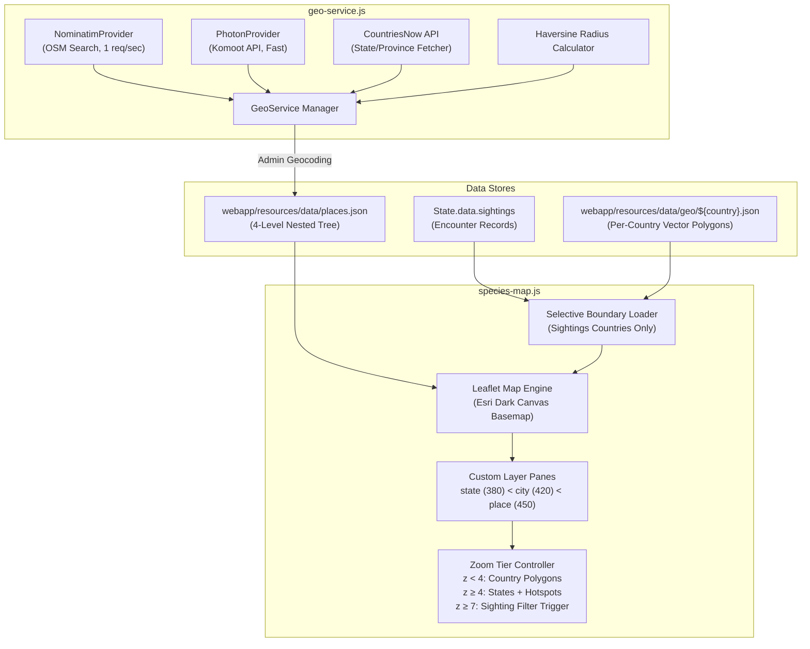
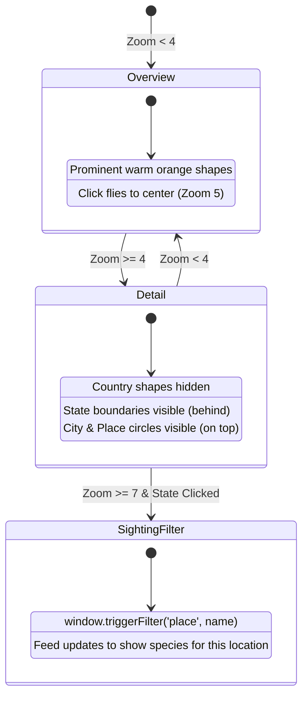

# Geocoding & Geographic Boundaries Architecture

This document provides a comprehensive technical reference for Telebirding's geographic infrastructure, the 4-level hierarchical model in `places.json`, the modular per-country GeoJSON boundary dataset, the swappable geocoding engine (`geo-service.js`), and the public Leaflet interactive map rendering pipeline (`species-map.js`).

---

## 1. System Architecture Overview

Telebirding uses a hybrid spatial architecture combining:
1. **Hierarchical Point Locations (`places.json`)**: A strictly nested tree defining coordinates (`lat`, `lng`) and representative radii (`radius` in km) for all sighting hotspots, cities, states, and countries.
2. **Modular Vector Polygons (`data/geo/${country}.json`)**: Granular country and provincial GeoJSON boundary polygons loaded selectively based on user sightings.
3. **Multi-Provider Geocoding Service (`geo-service.js`)**: An extensible client-side geocoding layer supporting OpenStreetMap Nominatim and Komoot Photon with automatic rate limiting and radius derivation.
4. **Interactive Public Species Map (`species-map.js`)**: A Leaflet-based world visualization that seamlessly transitions between country-level polygon coverage and state/city/hotspot circle clusters based on zoom depth.



---

## 2. 4-Level Location Hierarchy (`places.json`)

All spatial relationships in Telebirding are organized in a strict 4-level parent-child hierarchy in [places.json](file:///d:/Projects/telebirding/webapp/resources/data/places.json):

```text
Country
  └── State / Province / Territory
        └── City / District / Division
              └── Place / Sanctuary / Hotspot
```

### 2.1. JSON Schema

Each node in the tree stores geographic coordinates and a radius (in kilometers):

```json
{
  "countries": {
    "India": {
      "lat": 20.5937,
      "lng": 78.9629,
      "radius": 1000,
      "states": {
        "Karnataka": {
          "lat": 15.3173,
          "lng": 75.7139,
          "radius": 150,
          "cities": {
            "Bangalore": {
              "lat": 12.9716,
              "lng": 77.5946,
              "radius": 20,
              "places": {
                "Hessarghatta Grasslands": {
                  "lat": 13.1492,
                  "lng": 77.4912,
                  "radius": 5
                }
              }
            }
          }
        }
      }
    }
  }
}
```

### 2.2. Geographic Radius Caps (`GEO_RADIUS_CAPS`)

When geocoding returns an administrative bounding box, the calculated radius is clamped within strict minimum and maximum boundaries defined in [geo-service.js](file:///d:/Projects/telebirding/webapp/scripts/modules/geo-service.js#L40-L45) to avoid disproportionate or invisible circles:

| Hierarchy Level | Minimum Radius | Maximum Radius | Default Radius | Purpose |
| :--- | :--- | :--- | :--- | :--- |
| **`place`** | 1 km | 20 km | 5 km | Specific birding sanctuaries, lakes, or trails. |
| **`city`** | 5 km | 40 km | 20 km | Municipal areas, districts, or urban bounds. |
| **`state`** | 25 km | 200 km | 150 km | Provinces, states, or union territories. |
| **`country`** | 50 km | 1500 km | 1000 km | National continental boundaries. |

---

## 3. Modular Per-Country GeoJSON Boundaries

Rather than bundling a monolithic multi-megabyte global shapefile that slows initial page loads, Telebirding uses **modular per-country GeoJSON files** located in `webapp/resources/data/geo/${country}.json`.

### 3.1. File Schema

Each country file contains two root keys:
1. **`country`**: A GeoJSON `Feature` (usually `Polygon` or `MultiPolygon`) describing the national perimeter.
2. **`states`**: A GeoJSON `FeatureCollection` containing individual state/province boundary features.

```json
{
  "country": {
    "type": "Feature",
    "properties": {
      "name": "India",
      "adm0_a3": "IND"
    },
    "geometry": {
      "type": "MultiPolygon",
      "coordinates": [ ... ]
    }
  },
  "states": {
    "type": "FeatureCollection",
    "features": [
      {
        "type": "Feature",
        "properties": {
          "name": "Karnataka",
          "country": "India"
        },
        "geometry": {
          "type": "MultiPolygon",
          "coordinates": [ ... ]
        }
      }
    ]
  }
}
```

### 3.2. Selective Loading Mechanism

In [species-map.js](file:///d:/Projects/telebirding/webapp/scripts/modules/public/species-map.js#L570-L601), `loadBoundaries()` inspects recorded sightings to fetch **only** the GeoJSON files for countries actually represented in the current database:

```javascript
const sightingsCountries = new Set(
    (State?.data?.sightings || []).map(s => s.country).filter(Boolean)
);
const countryNames = Object.keys(countries).filter(country => {
    const c = countries[country];
    return (c && c.count > 0) || sightingsCountries.has(country);
});

await Promise.all(countryNames.map(async (country) => {
    const path = Util.getData(`data/geo/${country}.json`);
    const res = await fetch(path);
    if (res.ok) {
        const file = await res.json();
        if (file.country) geoCountries.features.push(file.country);
        if (file.states?.features) geoStates.features.push(...file.states.features);
    }
}));
```

### 3.3. Firebase Storage Limits
Per project rules in `storage.rules`, boundary files can reach up to **15 MB** to accommodate high-resolution coastline polygons (e.g., Natural Earth 10m cultural vectors).

---

## 4. Swappable Geocoding Engine (`geo-service.js`)

The geocoding subsystem provides a unified, extensible architecture for converting geographic names into coordinates and radii.

### 4.1. The `BaseGeoProvider` Contract

All providers implement the `BaseGeoProvider` abstract interface:

```typescript
interface GeoResult {
    lat: number;
    lng: number;
    radius: number;          // in kilometers
    displayName: string;
    provider: string;
    raw: object;
}

abstract class BaseGeoProvider {
    abstract lookup(options: {
        place?: string;
        city?: string;
        state?: string;
        country?: string;
        type?: 'place' | 'city' | 'state' | 'country';
    }): Promise<GeoResult | null>;
}
```

### 4.2. Supported Providers

#### 1. OpenStreetMap Nominatim (`NominatimProvider` — Default)
- **Endpoint**: `https://nominatim.openstreetmap.org/search`
- **Rate Limit Enforcement**: OSM policy mandates no more than **1 request per second**. `NominatimProvider` enforces this in `_enforceRateLimit()`:
  ```javascript
  const elapsed = Date.now() - this.lastRequestTime;
  if (elapsed < this.minDelayMs) {
      await new Promise(resolve => setTimeout(resolve, this.minDelayMs - elapsed));
  }
  this.lastRequestTime = Date.now();
  ```
- **Fallback Hierarchy Reduction**: If a specific `place` query yields no results, `NominatimProvider` automatically falls back to geocoding the `city` + `state` + `country`.

#### 2. Komoot Photon (`PhotonProvider` — Fast Alternative)
- **Endpoint**: `https://photon.komoot.io/api`
- **Characteristics**: ElasticSearch-backed OSM index, extremely fast, no 1-second delay requirement. Extent format `[minLon, maxLat, maxLon, minLat]` is parsed into radius bounds.

### 4.3. Radius Calculation: Haversine Bounding Box
Bounding box coordinates `[minLat, maxLat, minLon, maxLon]` returned by providers are converted into a radial distance in kilometers using the Haversine formula in [computeBoundingBoxRadius](file:///d:/Projects/telebirding/webapp/scripts/modules/geo-service.js#L27-L37):

$$d = 2 R \arcsin\left(\sqrt{\sin^2\left(\frac{\Delta \varphi}{2}\right) + \cos(\varphi_1)\cos(\varphi_2)\sin^2\left(\frac{\Delta \lambda}{2}\right)}\right)$$

The maximum distance from the center coordinates to all four bounding corners is calculated, rounded to whole kilometers, and clamped against `GEO_RADIUS_CAPS`.

---

## 5. Public Interactive Map Engine (`species-map.js`)

The species map provides public exploration of encounters across all geographic tiers.

### 5.1. Basemap & Bounding Constraints

- **Basemap**: Esri World Dark Gray Canvas (`https://server.arcgisonline.com/ArcGIS/rest/services/Canvas/World_Dark_Gray_Base/MapServer/tile/{z}/{y}/{x}`) matching the dark site aesthetic (`#232227`).
- **World Bounding**:
  ```javascript
  speciesMap = L.map('species-map', {
      minZoom: 2,
      maxBounds: [[-85, -180], [85, 180]],
      maxBoundsViscosity: 1.0
  });
  ```
  `minZoom: 2` prevents wide tablet/desktop monitors from shrinking the world into an unusable ribbon. `maxBoundsViscosity: 1.0` hard-locks panning to prevent users from bouncing into gray void space.

### 5.2. Custom Leaflet Panes & Z-Indexing

To prevent larger regional shapes from intercepting clicks intended for smaller hotspots, custom panes are created in [initSpeciesMap](file:///d:/Projects/telebirding/webapp/scripts/modules/public/species-map.js#L635-L646):

```javascript
statePane.style.zIndex = '380';
cityPane.style.zIndex  = '420';
placePane.style.zIndex = '450';
```

| Layer | Leaflet Pane | Z-Index | Visual Style |
| :--- | :--- | :--- | :--- |
| **Country** | `overlayPane` | 400 | Solid filled polygon / fallback circle |
| **State** | `statePane` | **380** | Faded dashed polygon (`6, 5`) or faint circle |
| **City** | `cityPane` | **420** | Lime green circular highlight |
| **Place** | `placePane` | **450** | Bright emerald circular marker (always top clickable) |

### 5.3. Zoom Tier Transitions & Interactive Triggers



- **Zoom Threshold `< 4` (`DETAIL_ZOOM_THRESHOLD`)**: Country shapes are displayed prominently; states and cities are hidden.
- **Zoom Threshold `≥ 4`**: Country shapes are removed; state boundaries (subtle, dashed `statePane`) and city/place circles appear.
- **State Click Behavior**:
  - If current zoom `< 7` (`STATE_ZOOM_THRESHOLD`): Flies into state bounds (`Math.max(boundsZoom, 7)`).
  - If current zoom `≥ 7`: Directly activates `window.triggerFilter('place', name)` to filter the public sightings list.
- **City / Hotspot Click**: Always triggers `window.triggerFilter('place', name)`.

### 5.4. Visual Encoding & Opacity Mapping

The color palette is strictly mapped across levels:
- **Country**: Warm Orange (`rgb(255, 160, 40)`)
- **State**: Teal / Cyan (`rgb(0, 200, 200)`)
- **City**: Warm Lime Green (`rgb(135, 215, 50)`)
- **Place**: Bright Emerald Green (`rgb(65, 215, 95)`)

**Opacity Mapping**: The opacity of each feature dynamically encodes species richness:

$$\text{opacity} = 0.25 + \left(\frac{\text{count}}{\text{maxCount}}\right) \times 0.75 \quad (\text{range } [0.25, 1.0])$$

Locations with higher encounter diversity appear brighter and more saturated.

### 5.5. Fullscreen Handling & Android Native Bridge

The map implements dual-mode fullscreen in [toggleFullscreen](file:///d:/Projects/telebirding/webapp/scripts/modules/public/species-map.js#L419-L477):
1. **Desktop Browsers**: Utilizes the HTML5 Fullscreen API (`requestFullscreen`).
2. **Android App (WebView)**: Bypasses HTML5 Fullscreen (which triggers unhandled `onShowCustomView` cancellations in standard WebViews) and communicates with the Android container via:
   ```javascript
   if (window.Android && typeof window.Android.setMapFullscreen === 'function') {
       window.Android.setMapFullscreen(isFullscreen);
   }
   ```
   The Android Compose layer catches this and coordinates the native top bar, status bar, and back press handler.

---

## 6. Administration & Cloud Synchronization

### 6.1. Adding New Countries & States
1. In the Admin Portal's Location Management card, select or add a country.
2. Clicking **Fetch States** calls [fetchStatesForCountry](file:///d:/Projects/telebirding/webapp/scripts/modules/geo-service.js#L323-L346) via the CountriesNow API to populate official provinces.
3. Batch re-geocoding iterates missing nodes with Nominatim/Photon and calculates coordinates and radii automatically.

### 6.2. Backup and Disaster Recovery
- **Backup Script**: [utils/backup.py](file:///d:/Projects/telebirding/utils/backup.py) creates point-in-time timestamped archives of `places.json` and all `geo/*.json` files.
- **Cloud Sync**: [utils/sync_dynamic_files_to_firebase_storage.py](file:///d:/Projects/telebirding/utils/sync_dynamic_files_to_firebase_storage.py) synchronizes modified dynamic JSON files to Firebase Storage buckets.
